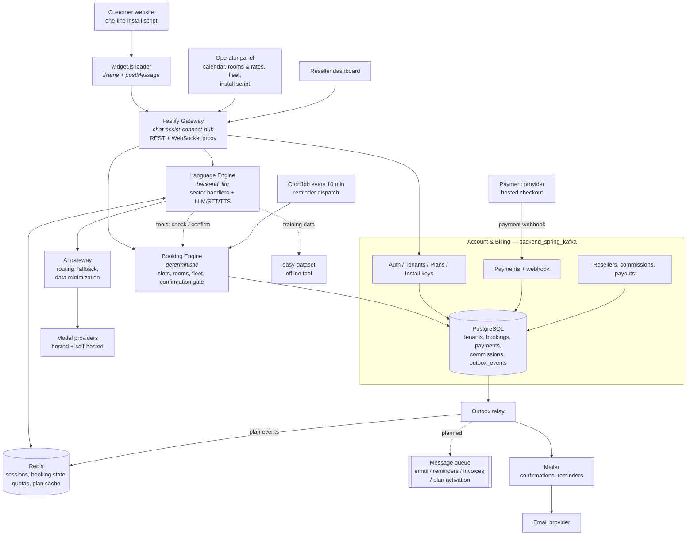
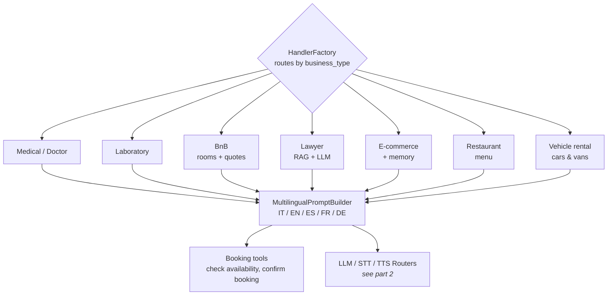
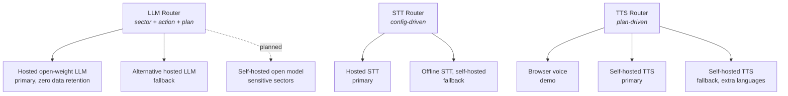

# Chatbot Infrastructure Architecture

## Author
Aldo Grandoni

> **Live demo: [telemaco.app](https://telemaco.app)**
>
> The demo is a **working test environment under continuous development**, not a finished product. It runs the same code described in this document and is updated frequently as new sectors, booking flows and features are added. Expect:
>
> - **sample businesses and data** (fictional doctors, BnB rooms, rental fleet), reset periodically;
> - **simulated bookings**: nothing is actually booked, and no real payment is taken;
> - **features at different stages**: some are complete, others are being refined, and behaviour or layout may change between visits;
> - **occasional downtime** during deployments.
>
> Feedback on anything that looks wrong is welcome and helps shape the next iterations.

## Public code samples

The production repositories are private. Three public repositories contain **rewritten extracts** that show the patterns used in the platform, without business logic, prompts, provider names or secrets:

| Repository | What it shows |
|---|---|
| [telemaco-billing-springboot] https://github.com/cloud-fullstack/telemaco-billing-springboot | Spring Boot 3 / Java 21: payment provider port, idempotent webhook, payment + plan activation + outbox in one transaction, outbox relay with `SKIP LOCKED`, Hibernate `@TenantId` isolation, Flyway, unit tests |
| [telemaco-operator-panel-react] https://github.com/cloud-fullstack/telemaco-operator-panel-react | React 18 / TypeScript (strict): fleet cards with edit modal, per-item REST API, availability calendar with debounced save, accessibility |
| [telemaco-platform-infra] https://github.com/cloud-fullstack/telemaco-platform-infra | Helm chart (stateless API, Redis with separate selectors, reminder CronJob, NetworkPolicies), Terraform private AKS module, Azure DevOps plan → approval → apply pipeline |

## Overview

**Telemaco** is a multi-tenant conversational AI platform: virtual assistants (voice and text) that small businesses embed into their own websites with a single line of HTML. Business owners (doctors, labs, lawyers, BnB owners, car and van rental agencies, restaurants, e-commerce shops) subscribe to the platform; their customers talk to the assistant to get answers and book appointments, rooms or vehicles, then receive confirmation and reminder emails.

The platform combines:

- a **language engine** (LLM, speech-to-text, text-to-speech) with configurable providers and fallbacks;
- a **deterministic booking engine**: availability and confirmations are decided by code, never by the model;
- **accounts, subscriptions, payments and a reseller programme**;
- **transactional email**, and dataset tooling for model fine-tuning.

It is made of seven private repositories deployed on a **k3s** cluster with Helm. External AI, payment and email providers are described by role, not by name: each one sits behind an internal interface and can be replaced through configuration.

### What changed in this revision

| Area | Before | Now |
|---|---|---|
| Onboarding | Widget configured manually | **One-line install script** with a personal key, downloadable from the customer area; works immediately in trial mode and activates itself when a plan is bought |
| Resellers | Not described | **Reseller programme**: approval, referral codes, per-payment commissions with holding period, clawbacks, monthly payouts |
| Tenant isolation | `tenant_id` columns | **Two barriers**: ORM-level filter (`@TenantId`) plus database Row-Level Security (planned) |
| LLM usage | Single provider | **Routing by sector and action**, fallback chain, circuit breakers, data minimization towards model providers |
| Messaging | Event broker with dedicated topics | Broker removed for now. **Transactional outbox** + relay; a message queue is planned when consumers grow |
| Payments | Not described | **Merchant-of-record provider** behind a `PaymentProvider` interface; the previous provider is kept only for existing subscribers |
| Plans | free / basic / premium / professional / enterprise | **demo → trial → bronze / silver / gold / platinum**, stored in DB, activated only by the payment webhook |
| Sectors | Medical, Lab, BnB, Lawyer, E-commerce, Restaurant | + **Vehicle rental (cars and vans)**; BnB rebuilt around rooms, capacity and seasonal rates |
| Conversation state | Files on the pod | **Redis**, so backend pods are stateless |
| Notifications | Notification service consuming broker events | **Mailer** for booking confirmations, **reminder CronJob**, GDPR-safe unsubscribe |

## System Architecture

**High-level platform flow:**



**Language Engine detail (`backend_llm`) — Part 1: sector routing:**



**Language Engine detail (`backend_llm`) — Part 2: pluggable provider routing:**



## Component Descriptions

### 1. `chat-assist-connect-hub` — Public Gateway, Widget and Operator Panel

Public entry layer of the platform. A **Node.js/Fastify** service plus the React front-end:

- **Install script and widget loader**: the customer pastes one line into the HTML of its website:

  ```html
  <script src="https://<widget-domain>/widget.js" data-tenant="pk_live_..." async></script>
  ```

  `widget.js` is a small loader that adds a chat button and opens the assistant in an **iframe** (`/embed`). The page inside the iframe verifies the key, loads the tenant's sector, name and plan, and renders the same React chat component used on the demo site. Loader and iframe talk through `postMessage`, accepted only from the platform origin, and the loader exposes a minimal API (`window.Telemaco.open()` / `close()`). Customers never receive application code, only the script line, so fixes reach every website without reinstalling.
- **Chat component**: one shared component for the demo site and for customer websites, configured through props (demo or embedded, tenant key, preset sector). Text and voice input (browser speech recognition, with recording sent to backend STT as fallback), male/female voice selector, hands-free mode with end-of-turn detection. Microphone and voice are hidden when the tenant's plan does not include voice.
- **Operator panel** (React): per-sector back office for business owners:
  - *Medical / lab / lawyer*: calendar where every slot starts **busy (orange)** and the professional marks free slots (**green**).
  - *BnB*: rooms and seasonal rates editor, with import from the property's website or a PDF price list and a "try a quote" box.
  - *Vehicle rental*: Agency → Rental conditions → Opening days calendar → Fleet → Chatbot bookings. Fleet shown as read-only cards with image, edited through a modal.
  - *All sectors*: **"The chatbot on your website"** section, under the calendar and at the bottom of the home page (see [Onboarding](#onboarding-install-script-and-widget-key)).
- **Reseller dashboard**: referral link and codes, referred customers, commissions by status, next payout.
- **REST proxy**: routes chat, TTS, widget verification, reminders, demo, tenant, billing and reseller APIs, injecting the service JWT. Tenant APIs (`/api/menu/*`, `/api/bnb/*`, `/api/rental/*`) go through a single generic handler that forwards method, path, body (JSON or PDF upload), cookie and authorization, with a longer timeout for LLM-based imports.
- **WebSocket proxy** (`/ws/chat`): validates `widget_key` and `Origin` before the upgrade, applies per-IP rate limiting, then forwards frames to the `backend_llm` WebSocket.
- **Security**: valid `widget_key`s, allowed origins per tenant, per-IP rate limiting.

The widget never knows the internal backend URL.

### 2. `backend_llm` — Language Engine and Booking Engine

**Python/FastAPI** service, the core of the conversational intelligence:

- **Chat/LLM**: hosted open-weight models as primary, an alternative provider as fallback; a self-hosted open model is planned for sensitive sectors.
- **STT**: hosted speech recognition as primary, offline self-hosted engine as fallback.
- **TTS**: browser voice for the demo; two self-hosted engines for paid plans, the second covering languages the first does not support.
- **RAG and Intent Recognition**: document search and intent recognition (multilingual embeddings kept in memory; no vector DB needed for intents). A fast single-token classification step decides whether a user turn is complete before the full answer is generated.
- **WebSocket chat**, optional messaging-channel sidecar.

Provider chains (primary, fallback, models, supported languages) are externalized in a configuration file loaded at runtime by a `ProviderConfigManager`, so providers can be switched without code changes.

#### LLM routing and resilience

- **Routing by sector, action and plan**: booking turns (check, reschedule, cancel, confirm) can use a fast model, while open questions in sensitive sectors use a stronger model; the plan decides which voice and model tiers are available.
- **Fallback chain** with timeouts, limited retries and a **circuit breaker** per provider: when a provider is slow or failing, traffic moves to the next one and the user still gets an answer.
- **Grounding**: availability, prices and totals are injected as data computed by the booking engine; the model may read them back but never invent or recompute them. Ambiguous or unclear turns trigger a short clarification question instead of a guess.
- **Per-plan quotas**: messages and voice characters are counted in Redis; when a voice quota is exhausted the assistant switches to the standard voice instead of failing.

#### Conversation state in Redis (stateless pods)

Conversation state was previously written to files on the pod, so a restart or a scale-out lost multi-turn context. It now lives in **Redis**:

- session history and booking state (pending slot, offered options, confirmed slot), keyed by session, with a short TTL; shared between text and voice so switching channel keeps context;
- per-plan message quotas and rate limits;
- a **local copy of each tenant's plan and limits**, updated from plan events, so the assistant keeps answering even if the billing service is briefly unavailable;
- optional cache of generic FAQ answers per tenant and language (never answers containing personal data).

Any replica can serve the next turn, which is the prerequisite for horizontal scaling. Generated audio is not meant to stay in Redis long-term; object storage is the planned target.

#### Booking engine (deterministic, not in the prompt)

All availability and booking decisions are code, not LLM output:

- **Confirmation gate**: a booking is created only if the slot was verified in a previous turn, the user gave an explicit yes (hesitant answers are rejected), and the requested slot matches one of the offered options. If the model claims a confirmation that did not happen, the text is corrected. Covered by unit tests.
- **Database is the final guard**: a constraint prevents overlapping bookings on the same resource (doctor slot, room, vehicle).
- Exposed as APIs used by chatbot tools, widget and operator panel. Planned: run it as a **separate Deployment** from the same codebase, so the calendar keeps working if LLM pods are slow.
- The end customer's email is **never asked in chat**: after confirmation the widget shows an email box with privacy consent.

#### Multi-Sector Business Handlers

A `HandlerFactory` routes each request to a handler by `business_type`:

- **Medical / Doctor** — appointment scheduling. Health data is a GDPR special category: no clinical content in logs.
- **Laboratory** — lab analysis booking.
- **BnB** — rooms, capacity, seasonal pricing, booking (see below).
- **Lawyer** — legal Q&A via RAG over uploaded documents, LLM fallback.
- **E-commerce** — products, order status, session memory.
- **Restaurant** — menu (importable from URL or PDF), orders, reservations.
- **Vehicle rental** — cars and vans: fleet, rental conditions, pickup/return dates (see below).
- **RAG / Document Q&A** — reused by other handlers.

Each handler builds its prompt through `MultilingualPromptBuilder` (IT/EN/ES/FR/DE). New sectors are added by implementing a handler and registering it in the factory; sectors are configuration (`business_verticals`), not separate services.

#### BnB sector

- **Data**: rooms (type, number of identical units, max adults, max children, total capacity, beds, cot, single-use price), seasonal rates (date range, price per room or per person, minimum nights), child-age pricing and offers.
- **Capacity filter in the backend, before the LLM**: `adults ≤ max_adults`, `adults + children ≤ capacity`, `children ≤ max_children`; results sorted by best fit (a solo guest is not offered a quadruple when a single is free; a double may be offered as "double for single use").
- **Pricing**: rooms, seasons and notes go into the prompt; totals are computed in code and the LLM may only read them back, never recompute. With no rooms configured, the bot does not quote prices and offers to leave a contact.
- **Import**: rates read from the property's website or a PDF price list. When prices are only shown by a third-party booking engine after date selection, the owner is asked to enter them manually; channel-manager integration is a future option.
- Guest count and requested dates persist across turns in the session state.

#### Vehicle-rental sector (cars and vans)

- **Data**: vehicles (name "or similar", category car/van, seats or load volume, daily price, quantity, image), rental bookings, agency hours and closing days.
- **Per-vehicle APIs** (create / update / delete one vehicle at a time); removing a vehicle with future bookings sets its quantity to 0.
- **Rules**: pickups only on the hour or half hour; opening hours validated server-side; the operator calendar opens on the current month and marks days that already have pickups.
- **Images**: generic category images (city car, sedan, wagon, SUV, 7-seat MPV, small/medium/large van, 9-seat minibus) with license credits, or the agency's own photos uploaded and resized server-side.

#### Transactional email

- **Mailer**: multilingual templates, standard one-click unsubscribe headers.
- **Confirmation**: sent in background after a confirmed booking with a start date (check-in for BnB, pickup for rental); tracked so it is sent once. No date, no email.
- **Reminders**: one reminder per booking 1–24 h before the start, skipping very recent bookings; failed sends retry on the next run. Triggered by a **CronJob every 10 minutes** through a token-protected endpoint.
- **Unsubscribe**: the link shows a confirmation page; only the explicit button deletes the address, because mail scanners open links automatically.
- **Deliverability**: SPF, DKIM and DMARC on the sending domain.

#### Pluggable LLM / STT / TTS Model Switching

Models are swapped through configuration: adding an LLM means adding a provider entry (any OpenAI-compatible endpoint), adding a spoken language for offline STT means dropping its model into a mounted volume, and adding a voice means registering it in the TTS voice map.

### 3. `backend_spring_kafka` — Account & Billing Services

**Spring Boot** services for everything that is not AI. The repository name is historical: the event broker has been removed for now (no consumers yet, extra operational cost).

- **Auth**: authentication and JWT. The JWT carries `tenant_id`. The **plan is read from the database**, never from the token, so a payment or suspension takes effect immediately.
- **Tenants and verticals**: tenant status `demo` → `trial` → `active` → `suspended`; business verticals. A demo tenant is converted at registration and becomes `active` **only when the payment webhook arrives**; a plan sent by the browser is ignored.
- **Install keys**: each tenant gets one public `widget_key` (`pk_live_…`) at registration, together with its allowed website domains. The key is not a secret: it identifies the tenant, and the backend decides what it can do from the tenant's plan and status.
- **Plans**: `demo`, `trial`, `bronze`, `silver`, `gold`, `platinum` (monthly/annual), stored in a table, deciding voice availability, message quotas, channels and which providers are used.
- **Payments**: provider behind a `PaymentProvider` interface (create checkout, parse webhook → common payment event):
  - a **merchant-of-record** provider for new subscribers in every EU country: the provider is the legal seller, collects and remits VAT per country and issues the invoice to each subscriber; the checkout collects the business VAT number so reverse charge applies to EU businesses; hosted checkout only, no card data on the platform;
  - the previous provider kept for existing subscribers until migrated; each subscription records which provider bills it, and the default for new signups is a DB setting;
  - webhook: verify signature → idempotency check → write payment **and** outbox event in the same transaction; a successful payment activates or renews, a failed payment or cancellation suspends.
- **Resellers**: see [Reseller programme](#reseller-programme).

**Events — transactional outbox.** Every business event (user registered, subscription activated, payment failed, subscription suspended, plan changed, booking confirmed, commission created) is written to `outbox_events` in the same transaction as the state change. A relay reads unpublished rows and delivers them; delivery is at-least-once, so consumers are idempotent. Today the relay is in-process; when consumers multiply it will publish to a replicated **message queue** with dedicated queues for email, reminders, invoices and plan activation, and a dead-letter queue. Switching broker only touches the relay.

**Ownership split (target).** Python owns conversation, models and the booking engine; Java owns tenants, verticals, resellers, subscriptions, checkout and webhook, payments, invoices and commissions, so payment and plan activation share one transaction. Until the migration is complete, payment tables are written by `backend_llm`.

### 4. `spring-client-chatbot` — Python Client for Spring Services

Python library (`SpringClient`) used by `backend_llm`: login and JWT validation, tenant plan and features lookup, booking-related calls for vertical use cases. Only IDs and plan/feature flags cross this boundary — no booking content, health data or payment details.

### 5. `easy-dataset` — Fine-Tuning Dataset Generation

Standalone internal tool (not exposed in production) that builds single-turn, multi-turn and image-QA datasets from PDF, Markdown, DOCX and EPUB documents, and exports them in standard fine-tuning formats for the self-hosted fallback model.

### 6. `k3s_engine_llm` — LLM Engine Helm Chart

- **Deployment** of the FastAPI service; the backend **Service selects only the API pods** (`component: api`).
- **Redis StatefulSet** with its **own selector labels** (`component: redis`). Previously Redis shared the backend selector labels and the backend Service sometimes routed requests to Redis, causing intermittent connection errors.
- Redis persistence and auto-generated password.
- **Secrets** for external provider keys, email, payments and internal tokens — never in the chart itself.
- **CronJob** for reminders (every 10 min, no concurrent runs).
- **NetworkPolicy**, optional sidecars, feature flags in `values.yaml`.

A simplified, public version of this chart is in [telemaco-platform-infra](https://github.com/<github-user>/telemaco-platform-infra).

### 7. `k3s_telemaco` — Frontend and Public Gateway Helm Chart

Frontend Nginx Deployment, gateway Deployment, Traefik Ingresses for the site, `api.` and `ws.` (exact path for `/ws/chat`), Traefik middleware (HSTS, CSP, rate limiting, CORS), ConfigMap for content-only updates.

## Onboarding: install script and widget key

The section **"The chatbot on your website"** appears in the customer area under the calendar and at the bottom of the home page, for every sector (medical, BnB, car and van rental, e-commerce and the others).

| Visitor | What they see | What happens |
|---|---|---|
| Not registered, or session expired | The script line blurred, with a **Download script** button | The button opens registration (or login), then returns to the same section |
| Registered, no paid plan | Their own script line, **Copy** and **Download** buttons, a "Free trial" badge | The key works immediately on their website with the demo limits |
| Registered, paid plan | Same line, "Active · <plan>" badge | The same key unlocks the plan's features: **no reinstall needed** |

Rules:

- **One key per tenant**, generated by the backend at registration; it is never chosen or sent by the browser.
- The key works only on the tenant's **allowed domains** (checked through the `Origin` header).
- Plan changes, suspensions and reactivations take effect on the next message, because the plan is read on the server.

## Reseller programme

Agencies and consultants can resell subscriptions and earn a commission on what their customers pay.

- **Application and approval**: a reseller registers with company name, VAT number and country and starts as `pending`; an admin approves it, and the backend creates its referral code (and the matching promotion code at the payment provider).
- **Attribution**: a tenant registered through a referral link or code is linked to the reseller; changing attribution is an admin action recorded with a reason.
- **Commissions**: one row per successful payment, calculated on the amount net of VAT. The reseller's **rate is copied onto each commission**, so a later rate change only affects future payments. Each commission becomes payable after a **holding period** that covers refunds and chargebacks.
- **Refunds and chargebacks**: a commission not yet paid is reversed; a commission already paid generates a **negative (clawback) row** deducted from the next payout.
- **Monthly payout job**: approves commissions whose holding period has passed, sums them per reseller (clawbacks included), skips amounts under a minimum threshold, and creates the payout. Payouts are sent by SEPA batch transfer approved by a person; the reseller invoices the platform for the commission.
- **Fraud controls**: changes to payout bank details require email confirmation; bank details are never stored in clear text in the commissions tables.
- **APIs**: reseller dashboard (customers, recurring revenue brought in, commissions by status, next payout), commission and payout history, admin approval and payout confirmation.

## Multi-tenancy and data isolation

All tenants share one PostgreSQL database. Isolation is enforced in layers, so a single bug does not expose another tenant's data:

1. **Tenant from the token, never from the request**: the tenant comes from the JWT; webhooks and background jobs take it from verified data (payment metadata, outbox rows) and set it for the duration of the operation only. If no tenant is set, the request fails.
2. **ORM-level filter**: every tenant-owned entity carries a `tenant_id` annotated with Hibernate `@TenantId`, which adds the tenant filter to every query and fills the column on insert. Public sample: [telemaco-billing-springboot](https://github.com/<github-user>/telemaco-billing-springboot).
3. **Database Row-Level Security** (planned): a PostgreSQL policy on the same column also protects native queries and hand-written SQL.
4. **Sensitive sectors flagged**: medical and legal verticals are marked in `business_verticals` and get stricter logging and model routing.
5. **Network isolation**: Kubernetes NetworkPolicies limit which pods can reach the API, Redis and the database.

## Typical Request Flows

**End customer books through the chatbot**

1. The customer opens the assistant on the business website (voice or text); the loader opens the iframe with the tenant key.
2. WebSocket → Traefik → gateway, which validates `widget_key`, `Origin` and rate limits.
3. `backend_llm` loads the session, booking state and tenant plan from Redis; voice input goes through STT (primary → fallback).
4. The sector handler builds the prompt (with rooms/fleet/slots where relevant) and calls the LLM through the router (primary → fallback).
5. Availability comes from booking-engine tools; the confirmation gate passes, and the booking plus an outbox event are written in one transaction.
6. The reply is optionally synthesized (TTS primary → fallback) and streamed back; session state is saved to Redis.
7. The customer enters the email in the consent box; the mailer sends the confirmation and the CronJob sends the reminder later.

**Business owner installs and subscribes**

1. Registration converts the demo tenant to `trial` and creates its `widget_key`.
2. The owner copies or downloads the install script and pastes it into the website: the assistant works immediately with trial limits.
3. The owner picks a plan → hosted checkout of the payment provider.
4. Payment webhook → idempotency check → payment + outbox event in one transaction → plan activated, tenant `active`.
5. The relay delivers the event: the engine's plan cache is updated (the same script now has the plan's features), welcome email, reseller commission if the tenant was referred, invoices.

## Security and Privacy

- **Authentication**: JWT with `tenant_id`; plan always read from DB.
- **Widget validation**: `widget_key` and allowed `Origin` checked before every WebSocket upgrade; loader and iframe exchange messages only with the platform origin.
- **Rate limiting**: gateway (per IP), Traefik (global), per-plan quotas in Redis.
- **Payments**: no card data touches the platform (hosted checkout); webhooks signature-verified and idempotent.
- **Data minimization towards AI providers**:
  - prompts carry only what the turn needs; no payment or account data is sent to model providers; email addresses are collected outside the chat;
  - open-weight models on providers with **zero data retention** and no training on customer data; third-party models that the provider forwards to another company are not used for sensitive sectors;
  - **no prompt or answer text in logs**: only model, region, token counts and request IDs;
  - planned: an **AI gateway** that redacts personal data (names, phone numbers, tax codes, addresses) before a prompt leaves the platform and restores it in the answer, with automated tests on synthetic data, and a self-hosted model for medical tenants.
- **Compliance documents**: data processing agreements with every sub-processor, and a data protection impact assessment for the medical sector.
- **Email**: consent before storing addresses, explicit-click unsubscribe, SPF/DKIM/DMARC.
- **Secrets**: Kubernetes Secrets, never hardcoded. **TLS** via cert-manager.
- **Resilience**: fallback chains and circuit breakers for LLM, STT and TTS; the outbox guarantees no event is lost if a consumer is down; the plan cache keeps the assistant working if billing is briefly down.

## Deployment

1. **`k3s_engine_llm`**: `helm upgrade` of the backend chart (engine, Redis, CronJob).
2. **`k3s_telemaco`**: `helm upgrade` of the frontend + public gateway chart.
3. **`backend_spring_kafka`**: Maven build of the Spring Boot services, deploy via their charts.
4. **Database migrations** (outbox, payments, BnB, rental, reseller, commission and subscription tables) applied before the related code release.
5. Content-only updates via ConfigMap; code updates require image rebuild, import into k3s, and `helm upgrade`.

## Open Items

- Move payments, invoices, commissions and payouts from `backend_llm` to the Spring service.
- Confirm EU-wide invoicing with the merchant-of-record provider: invoices with the customer's VAT number and reverse-charge mention where it applies, local VAT for non-business customers, and coverage of national e-invoicing mandates.
- Enable PostgreSQL Row-Level Security on tenant-owned tables.
- Build the AI gateway (personal-data redaction, routing by sector, audit log without content) and the self-hosted model for medical tenants.
- Choose the automated payout channel for resellers (SEPA batch today; provider payouts if available for the company's country).
- Introduce the message queue and an email queue (retry with backoff, dead-letter queue) before email volumes exceed provider limits.
- Run the booking engine as its own Deployment.
- Add the overlapping-booking DB constraint for rooms and vehicles.
- Align BnB availability calendar with configured rooms, so price and availability refer to the same room.

## Repository status

| Repository | Visibility | Status |
|---|---|---|
| `chat-assist-connect-hub`, `backend_llm`, `backend_spring_kafka`, `spring-client-chatbot`, `easy-dataset`, `k3s_engine_llm`, `k3s_telemaco` | Private | Developed and tested on the k3s staging cluster; synchronization of the latest changes to the remote repositories is in progress |
| `telemaco-billing-springboot`, `telemaco-operator-panel-react`, `telemaco-platform-infra` | **Public** | Code samples for review, see [Public code samples](#public-code-samples) |