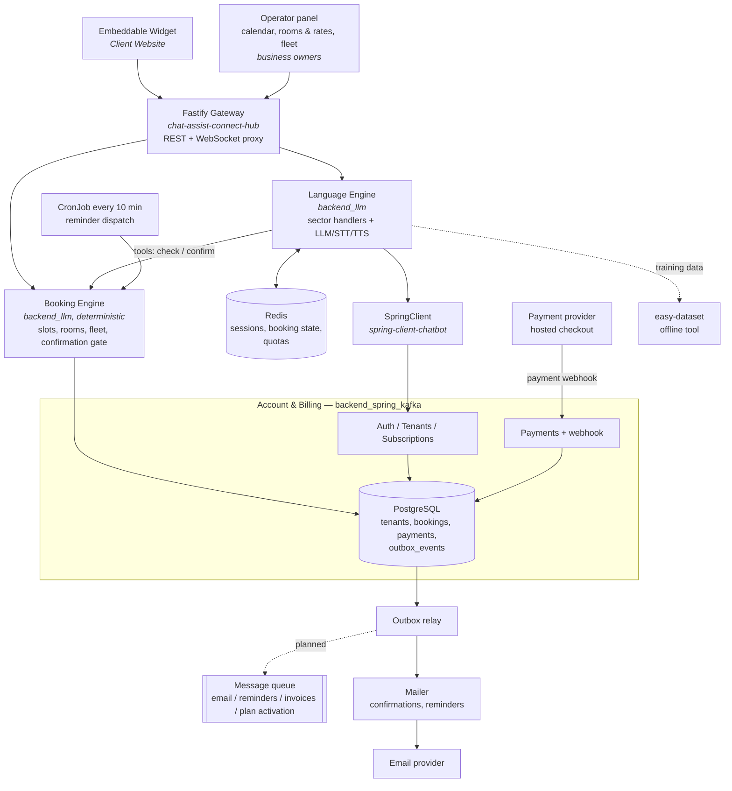
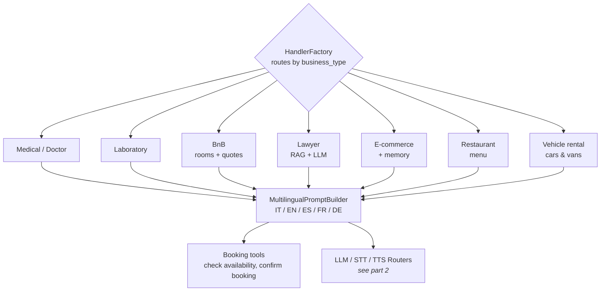
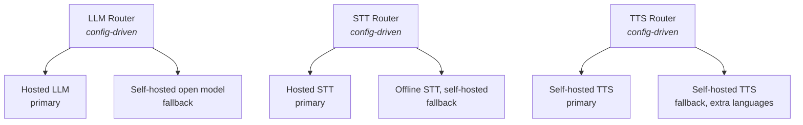

# Chatbot Infrastructure Architecture

## Author
Aldo Grandoni

> **Live demo: [telemaco.app](https://telemaco.app)**
>
> The demo is a **working test environment under continuous development**, not a finished product. It runs the same code described in this document and is updated frequently as new sectors, booking flows and features are added. Expect:
>
> - **sample businesses and data** (fictional doctors, BnB rooms, rental fleet), reset periodically;
> - **simulated bookings**: nothing is actually booked, and no real payment is taken;
> - **features at different stages**: some are complete, others are being refined, and behaviour or layout may change between visits;
> - **occasional downtime** during deployments.
>
> Feedback on anything that looks wrong is welcome and helps shape the next iterations.

## Overview

This document describes the architecture of **Telemaco**, a conversational chatbot platform: a multi-tenant system that provides virtual assistants (voice + text) embeddable into third-party websites. Business owners (doctors, labs, lawyers, BnB owners, vehicle-rental agencies, restaurants, e-commerce shops) subscribe to the platform; their end customers talk to the assistant and book appointments, rooms or vehicles, receiving confirmation and reminder emails.

The platform is backed by a language-processing engine (LLM/STT/TTS), a deterministic booking engine, authentication, subscription and payment management, transactional email, and dataset-generation tooling for model fine-tuning.

It is composed of seven independent repositories, orchestrated on a **k3s** cluster via Helm.

External AI, payment and email providers are deliberately described by role, not by name: each one sits behind an internal interface and can be replaced through configuration.

### What changed in this revision

| Area | Before | Now |
|---|---|---|
| Messaging | Event broker with dedicated topics | Broker removed for now. **Transactional outbox** (`outbox_events`) + relay; a message queue is planned when consumers grow |
| Payments | Not described | **Merchant-of-record payment provider** behind a `PaymentProvider` interface; the previous provider is kept only for existing subscribers |
| Plans | free / basic / premium / professional / enterprise | **demo → trial → bronze / silver / gold / platinum**, stored in DB, activated only by payment webhook |
| Sectors | Medical, Lab, BnB, Lawyer, E-commerce, Restaurant | + **Vehicle rental (cars and vans)**; BnB rebuilt around rooms, capacity and seasonal rates |
| Conversation state | Files on the pod | **Redis** → backend pods are stateless |
| Notifications | Notification service consuming broker events | **Mailer** for booking confirmations, **reminder CronJob**, GDPR-safe unsubscribe |

## System Architecture

**High-level platform flow:**

**Language Engine detail (`backend_llm`) — Part 1: sector routing:**

**Language Engine detail (`backend_llm`) — Part 2: pluggable provider routing:**

## Component Descriptions

### 1. `chat-assist-connect-hub` — Public Gateway, Widget and Operator Panel

Public entry layer of the platform. A **Node.js/Fastify** service that exposes:

- **Embeddable JavaScript widget**: a lightweight script (~50KB) to drop into any client website. UI only (chat bubble, voice button, email-consent box), environment detection, communication with the gateway. Microphone and voice are hidden when the tenant's plan does not include voice.
- **Operator panel** (React): per-sector back office for business owners:
  - *Medical / lab / lawyer*: calendar where every slot starts **busy (orange)** and the professional marks free slots (**green**).
  - *BnB*: rooms and seasonal rates editor, with import from the property's website or a PDF price list and a "try a quote" box.
  - *Vehicle rental*: Agency → Rental conditions → Opening days calendar → Fleet → Chatbot bookings. Fleet shown as read-only cards with image, edited through a modal.
- **REST proxy**: routes chat, TTS, widget verification, reminders, demo and tenant APIs to `backend_llm`, injecting the service JWT. Tenant APIs (`/api/menu/*`, `/api/bnb/*`, `/api/rental/*`) go through a single generic handler that forwards method, path, body (JSON or PDF upload), cookie and authorization, with a longer timeout for LLM-based imports.
- **WebSocket proxy** (`/ws/chat`): validates `widget_key` and `Origin` before the upgrade, applies per-IP rate limiting, then forwards frames to the `backend_llm` WebSocket.
- **Security**: whitelist of valid `widget_key`s, allowed CORS origins, in-memory per-IP rate limiting.

The widget never knows the internal backend URL.

### 2. `backend_llm` — Language Engine and Booking Engine

**Python/FastAPI** service, the core of the conversational intelligence:

- **Chat/LLM**: hosted LLM as primary, self-hosted open model as fallback.
- **STT**: hosted speech recognition as primary, offline self-hosted engine as fallback.
- **TTS**: two self-hosted engines, the second covering languages the first does not support.
- **RAG and Intent Recognition**: document search and intent recognition (multilingual embeddings kept in memory; no vector DB needed for intents).
- **WebSocket chat**, optional messaging-channel sidecar.

Provider chains (primary, fallback, models, supported languages) are externalized in a configuration file loaded at runtime by a `ProviderConfigManager`, so providers can be switched without code changes.

#### Conversation state in Redis (stateless pods)

Conversation state was previously written to files on the pod, so a restart or a scale-out lost multi-turn context. It now lives in **Redis**:

- session history and booking state (pending slot, offered options, confirmed slot), keyed by session, with a short TTL; shared between text and voice so switching channel keeps context;
- per-plan message quotas and rate limits;
- optional cache of generic FAQ answers per tenant and language (never answers containing personal data).

Any replica can serve the next turn, which is the prerequisite for horizontal scaling. Generated audio is not meant to stay in Redis long-term; object storage is the planned target.

#### Booking engine (deterministic, not in the prompt)

All availability and booking decisions are code, not LLM output:

- **Confirmation gate**: a booking is created only if the slot was verified in a previous turn, the user gave an explicit yes (hesitant answers are rejected), and the requested slot matches one of the offered options. If the model claims a confirmation that did not happen, the text is corrected. Covered by unit tests.
- **Database is the final guard**: a constraint prevents overlapping bookings on the same resource (doctor slot, room, vehicle).
- Exposed as APIs used by chatbot tools, widget and operator panel. Planned: run it as a **separate Deployment** from the same codebase, so the calendar keeps working if LLM pods are slow.
- The end customer's email is **never asked in chat**: after confirmation the widget shows an email box with privacy consent.

#### Multi-Sector Business Handlers

A `HandlerFactory` routes each request to a handler by `business_type`:

- **Medical / Doctor** — appointment scheduling. Health data is a GDPR special category: no clinical content in logs.
- **Laboratory** — lab analysis booking.
- **BnB** — rooms, capacity, seasonal pricing, booking (see below).
- **Lawyer** — legal Q&A via RAG over uploaded documents, LLM fallback.
- **E-commerce** — products, order status, session memory.
- **Restaurant** — menu (importable from URL or PDF), orders, reservations.
- **Vehicle rental** — cars and vans: fleet, rental conditions, pickup/return dates (see below).
- **RAG / Document Q&A** — reused by other handlers.

Each handler builds its prompt through `MultilingualPromptBuilder` (IT/EN/ES/FR/DE). New sectors are added by implementing a handler and registering it in the factory; sectors are configuration (`business_verticals`), not separate services.

#### BnB sector

- **Data**: rooms (type, number of identical units, max adults, max children, total capacity, beds, cot, single-use price), seasonal rates (date range, price per room or per person, minimum nights), child-age pricing and offers.
- **Capacity filter in the backend, before the LLM**: `adults ≤ max_adults`, `adults + children ≤ capacity`, `children ≤ max_children`; results sorted by best fit (a solo guest is not offered a quadruple when a single is free; a double may be offered as "double for single use").
- **Pricing**: rooms, seasons and notes go into the prompt; totals are computed in code and the LLM may only read them back, never recompute. With no rooms configured, the bot does not quote prices and offers to leave a contact.
- **Import**: rates read from the property's website or a PDF price list. When prices are only shown by a third-party booking engine after date selection, the owner is asked to enter them manually; channel-manager integration is a future option.
- Guest count and requested dates persist across turns in the session state.

#### Vehicle-rental sector (cars and vans)

- **Data**: vehicles (name "or similar", category car/van, seats or load volume, daily price, quantity, image), rental bookings, agency hours and closing days.
- **Per-vehicle APIs** (create / update / delete one vehicle at a time); removing a vehicle with future bookings sets its quantity to 0.
- **Rules**: pickups only on the hour or half hour; opening hours validated server-side; the operator calendar opens on the current month and marks days that already have pickups.
- **Images**: generic category images (city car, sedan, wagon, SUV, 7-seat MPV, small/medium/large van, 9-seat minibus) with license credits, or the agency's own photos uploaded and resized server-side.

#### Transactional email

- **Mailer**: multilingual templates, standard one-click unsubscribe headers.
- **Confirmation**: sent in background after a confirmed booking with a start date (check-in for BnB, pickup for rental); tracked so it is sent once. No date, no email.
- **Reminders**: one reminder per booking 1–24 h before the start, skipping very recent bookings; failed sends retry on the next run. Triggered by a **CronJob every 10 minutes** through a token-protected endpoint.
- **Unsubscribe**: the link shows a confirmation page; only the explicit button deletes the address, because mail scanners open links automatically.
- **Deliverability**: SPF, DKIM and DMARC on the sending domain.

#### Pluggable LLM / STT / TTS Model Switching

Models are swapped through configuration: adding an LLM means adding a provider entry (any OpenAI-compatible endpoint), adding a spoken language for offline STT means dropping its model into a mounted volume, and adding a voice means registering it in the TTS voice map.

### 3. `backend_spring_kafka` — Account & Billing Services

**Spring Boot** services for everything that is not AI. The repository name is historical: the event broker has been removed for now (no consumers yet, extra operational cost).

- **Auth**: authentication and JWT. The JWT carries `tenant_id`. The **plan is read from the database**, never from the token, so a payment or suspension takes effect immediately.
- **Tenants and verticals**: tenant status `demo` → `trial` → `active` → `suspended`; business verticals; resellers. A demo tenant is converted at registration and becomes `active` **only when the payment webhook arrives**; a plan sent by the browser is ignored.
- **Plans**: `demo`, `trial`, `bronze`, `silver`, `gold`, `platinum` (monthly/annual), stored in a table, deciding voice availability, message quotas and which providers are used.
- **Payments**: provider behind a `PaymentProvider` interface (create checkout, parse webhook → common payment event):
  - a **merchant-of-record** provider for new subscribers in every EU country: the provider is the legal seller, collects and remits VAT per country and issues the invoice to each subscriber; the checkout collects the business VAT number so reverse charge applies to EU businesses; hosted checkout only, no card data on the platform;
  - the previous provider kept for existing subscribers until migrated; each subscription records which provider bills it, and the default for new signups is a DB setting;
  - webhook: verify signature → idempotency check → write payment **and** outbox event in the same transaction; a successful payment activates or renews, a failed payment or cancellation suspends;
  - reseller commissions and payouts are derived from payments and handled internally.
- **Tenant isolation**: shared PostgreSQL with a `tenant_id` on every tenant-owned table, enforced at ORM level; sensitive verticals (medical, legal) flagged.

**Events — transactional outbox.** Every business event (user registered, subscription activated, payment failed, subscription suspended, plan changed, booking confirmed) is written to `outbox_events` in the same transaction as the state change. A relay reads unpublished rows and delivers them; delivery is at-least-once, so consumers are idempotent. Today the relay is in-process; when consumers multiply it will publish to a replicated **message queue** with dedicated queues for email, reminders, invoices and plan activation, and a dead-letter queue. Switching broker only touches the relay.

**Ownership split (target).** Python owns conversation, models and the booking engine; Java owns tenants, verticals, resellers, subscriptions, checkout and webhook, payments, invoices and commissions, so payment and plan activation share one transaction. Until the migration is complete, payment tables are written by `backend_llm`.

### 4. `spring-client-chatbot` — Python Client for Spring Services

Python library (`SpringClient`) used by `backend_llm`: login and JWT validation, tenant plan and features lookup, booking-related calls for vertical use cases. Only IDs and plan/feature flags cross this boundary — no booking content, health data or payment details.

### 5. `easy-dataset` — Fine-Tuning Dataset Generation

Standalone internal tool (not exposed in production) that builds single-turn, multi-turn and image-QA datasets from PDF, Markdown, DOCX and EPUB documents, and exports them in standard fine-tuning formats for the self-hosted fallback model.

### 6. `k3s_engine_llm` — LLM Engine Helm Chart

- **Deployment** of the FastAPI service; the backend **Service selects only the API pods** (`component: api`).
- **Redis StatefulSet** with its **own selector labels** (`component: redis`). Previously Redis shared the backend selector labels and the backend Service sometimes routed requests to Redis, causing intermittent connection errors.
- Redis persistence and auto-generated password.
- **Secrets** for external provider keys, email, payments and internal tokens — never in the chart itself.
- **CronJob** for reminders (every 10 min, no concurrent runs).
- **NetworkPolicy**, optional sidecars, feature flags in `values.yaml`.

### 7. `k3s_telemaco` — Frontend and Public Gateway Helm Chart

Frontend Nginx Deployment, gateway Deployment, Traefik Ingresses for the site, `api.` and `ws.` (exact path for `/ws/chat`), Traefik middleware (HSTS, CSP, rate limiting, CORS), ConfigMap for content-only updates.

## Typical Request Flows

**End customer books through the chatbot**

1. The customer opens the widget on the business website (voice or text).
2. WebSocket → Traefik → gateway, which validates `widget_key`, `Origin` and rate limits.
3. `backend_llm` loads the session and booking state from Redis; voice input goes through STT (primary → fallback).
4. The sector handler builds the prompt (with rooms/fleet/slots where relevant) and calls the LLM (primary → fallback).
5. Availability comes from booking-engine tools; the confirmation gate passes, and the booking plus an outbox event are written in one transaction.
6. The reply is optionally synthesized (TTS primary → fallback) and streamed back; session state is saved to Redis.
7. The customer enters the email in the consent box; the mailer sends the confirmation and the CronJob sends the reminder later.

**Business owner subscribes**

1. Registration converts the demo tenant to `trial`.
2. The owner picks a plan → hosted checkout of the payment provider.
3. Payment webhook → idempotency check → payment + outbox event in one transaction → plan activated, tenant `active`.
4. The relay delivers the event to consumers (widget key unlocked, welcome email, reseller commission, invoices).

## Security and Privacy

- **Authentication**: JWT with `tenant_id`; plan always read from DB.
- **Widget validation**: `widget_key` and `Origin` whitelist before every WebSocket upgrade.
- **Rate limiting**: gateway (per IP), Traefik (global), per-plan quotas in Redis.
- **Payments**: no card data touches the platform (hosted checkout); webhooks signature-verified and idempotent.
- **Data minimization towards AI providers**: prompts carry only what the turn needs; no payment or account data is sent to model providers; email addresses are collected outside the chat.
- **Email**: consent before storing addresses, explicit-click unsubscribe, SPF/DKIM/DMARC.
- **Secrets**: Kubernetes Secrets, never hardcoded. **TLS** via cert-manager.
- **Resilience**: self-hosted fallback for LLM, STT and TTS; the outbox guarantees no event is lost if a consumer is down.

## Deployment

1. **`k3s_engine_llm`**: `helm upgrade` of the backend chart (engine, Redis, CronJob).
2. **`k3s_telemaco`**: `helm upgrade` of the frontend + public gateway chart.
3. **`backend_spring_kafka`**: Maven/Gradle build of the Spring Boot services, deploy via their charts.
4. **Database migrations** (outbox, payments, BnB, rental, reseller and subscription tables) applied before the related code release.
5. Content-only updates via ConfigMap; code updates require image rebuild, import into k3s, and `helm upgrade`.

## Open Items

- Move payments, invoices and commissions from `backend_llm` to the Spring service.
- Confirm EU-wide invoicing with the merchant-of-record provider: subscribers are businesses in all EU countries, so check that invoices carry the customer's VAT number and the reverse-charge mention where it applies, that local VAT is applied to non-business customers, and that national e-invoicing mandates (structured invoices sent through a government platform, already required in some countries and being extended EU-wide) are covered by the provider or need a separate integration.
- Introduce the message queue and an email queue (retry with backoff, dead-letter queue) before email volumes exceed provider limits.
- Run the booking engine as its own Deployment.
- Add the overlapping-booking DB constraint for rooms and vehicles.
- Align BnB availability calendar with configured rooms, so price and availability refer to the same room.

## Status

⚠️ This codebase has been developed and tested locally / on the k3s staging cluster but has **not yet been pushed to the corresponding GitHub repositories**. The remote repositories currently reflect an earlier state of the project. Synchronization is pending.
