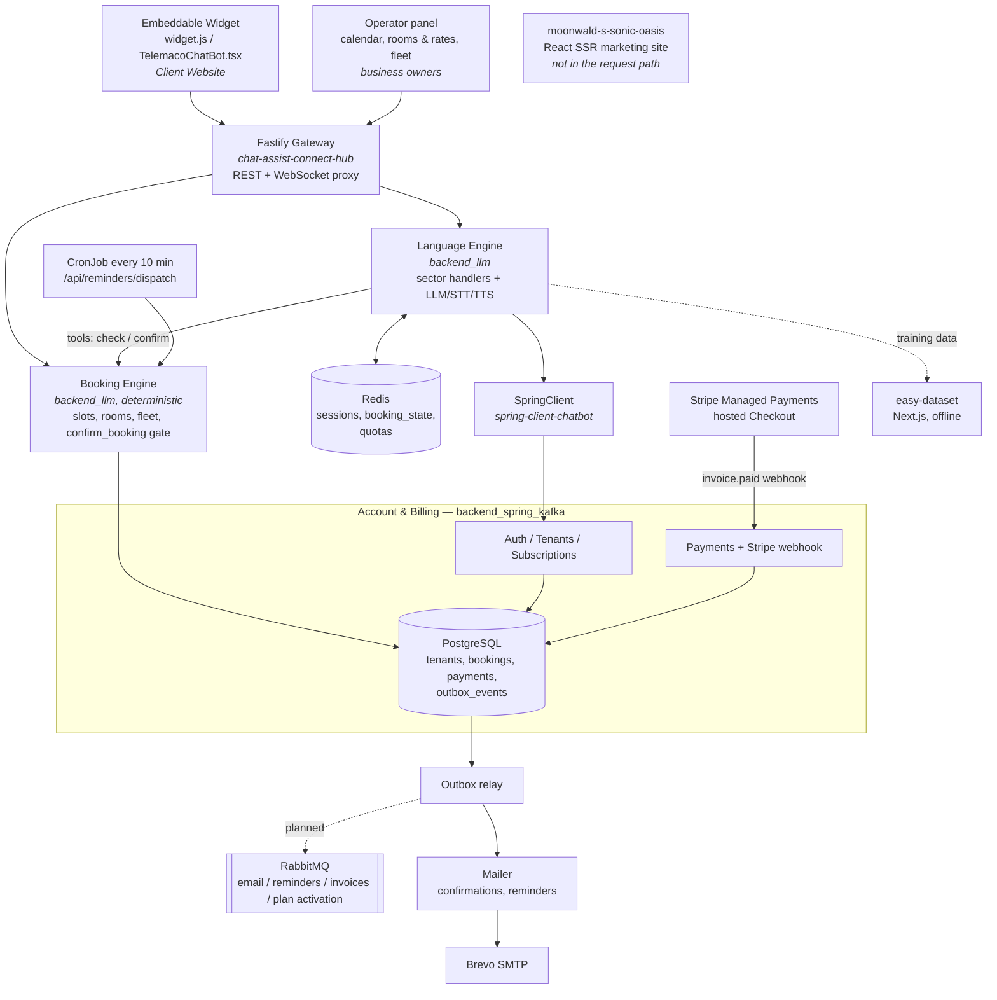
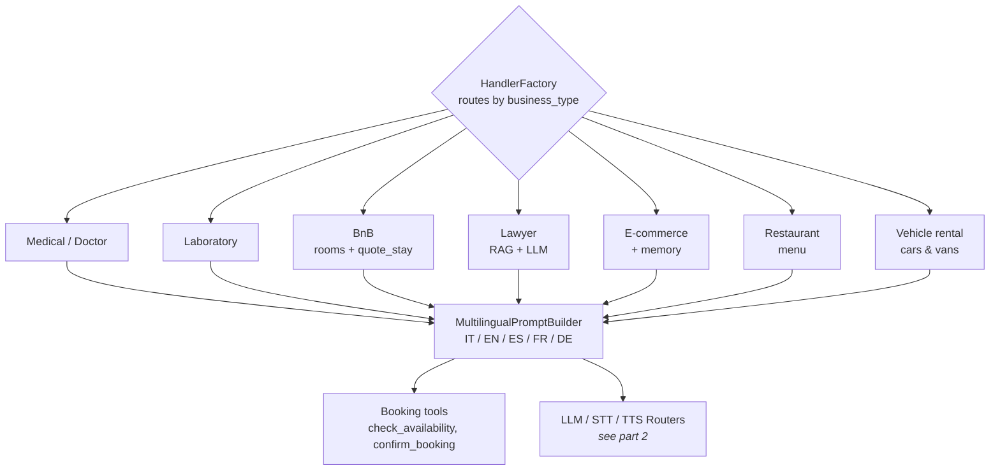
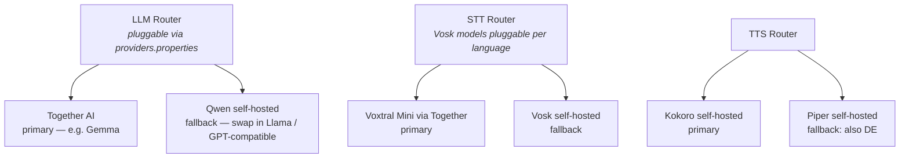

# Chatbot Infrastructure Architecture

## Author
Aldo Grandoni

> **Live demo: [telemaco.app](https://telemaco.app)**
>
> The demo is a **working test environment under continuous development**, not a finished product. It runs the same code described in this document and is updated frequently as new sectors, booking flows and features are added. Expect:
>
> - **sample businesses and data** (fictional doctors, BnB rooms, rental fleet), reset periodically;
> - **simulated bookings**: nothing is actually booked, and no real payment is taken;
> - **features at different stages**: some are complete, others are being refined, and behaviour or layout may change between visits;
> - **occasional downtime** during deployments.
>
> Feedback on anything that looks wrong is welcome and helps shape the next iterations.

## Overview

This document describes the architecture of the Conversational chatbot platform: a multi-tenant system that provides virtual assistants (voice + text) embeddable into third-party websites. Business owners (doctors, labs, lawyers, BnB owners, vehicle-rental agencies, restaurants, e-commerce shops) subscribe to the platform; their end customers talk to the assistant and book appointments, rooms or vehicles, receiving confirmation and reminder emails.

The platform is backed by a language-processing engine (LLM/STT/TTS), a deterministic booking engine, authentication, subscription and payment management, transactional email, and dataset-generation tooling for model fine-tuning.

It is composed of seven independent repositories, orchestrated on a **k3s** cluster via Helm.

### What changed in this revision

| Area | Before | Now |
|---|---|---|
| Messaging | Kafka (`user.auth.events`, `plan.updates`, `auth_errors`) | Kafka removed. **Transactional outbox** (`outbox_events`) + relay; RabbitMQ planned when consumers grow |
| Payments | Not described | **Stripe Managed Payments** (merchant of record) behind a `PaymentProvider` interface; Lemon Squeezy kept only for existing subscribers |
| Plans | free / basic / premium / professional / enterprise | **demo → trial → bronze / silver / gold / platinum**, stored in DB, activated only by payment webhook |
| Sectors | Medical, Lab, BnB, Lawyer, E-commerce, Restaurant | + **Vehicle rental (cars and vans)**; BnB rebuilt around rooms, capacity and seasonal rates |
| Conversation state | JSONL files on the pod | **Redis** → backend pods are stateless |
| Notifications | `notification-service` consuming Kafka | **Mailer** (SMTP/Brevo) for booking confirmations, **reminder CronJob**, GDPR-safe unsubscribe |

## System Architecture

**High-level platform flow:**

**Language Engine detail (`backend_llm`) — Part 1: sector routing:**

**Language Engine detail (`backend_llm`) — Part 2: pluggable provider routing:**

## Component Descriptions

### 1. `chat-assist-connect-hub` — Public Gateway, Widget and Operator Panel

Public entry layer of the platform. A **Node.js/Fastify** service that exposes:

- **Embeddable JavaScript widget** (`widget.js`, `chatbot-widget.js`): a lightweight script (~50KB) to drop into any client website. UI only (chat bubble, voice button, email-consent box), environment detection, communication with the gateway. The widget hides microphone and voice when `/api/v1/widget/verify` returns `features.voice = false` (Bronze plan).
- **Operator panel** (React): per-sector back office for business owners:
  - *Medical / lab / lawyer*: calendar where every slot starts **busy (orange)** and the professional marks free slots (**green**).
  - *BnB*: rooms and seasonal rates editor (`RoomRatesEditor`), with import from website URL or PDF price list and a "try a quote" box.
  - *Vehicle rental*: `RentalOperatorPanel` in the order Agency → Rental conditions → Opening days calendar → Fleet → Chatbot bookings. Fleet shown as read-only cards with image, edited through a modal; category images from Wikimedia Commons stored locally (`public/fleet/`, credits in `ATTRIBUTION.txt`, mapping in `src/lib/fleetImages.ts`).
- **REST proxy**: routes `/api/chat`, `/api/tts`, `/api/tts/features`, `/api/v1/widget/verify`, `/api/reminders`, `/api/demo/*` and the tenant APIs to `backend_llm`, injecting the service JWT. Tenant APIs (`/api/menu/*`, `/api/bnb/*`, `/api/rental/*`) go through a single generic handler (`proxyTenantApi`) that forwards method, path, body (JSON or multipart PDF), cookie and authorization, with a 150 s timeout for LLM-based imports and no body-size cap for PDFs up to 10 MB.
- **WebSocket proxy** (`/ws/chat`): validates `widget_key` and `Origin` before the upgrade, applies per-IP rate limiting, then forwards frames to the `backend_llm` WebSocket.
- **Security**: whitelist of valid `widget_key`s, allowed CORS origins, in-memory per-IP rate limiting.

The widget never knows the internal backend URL.

### 2. `backend_llm` — Language Engine and Booking Engine

**Python/FastAPI** service, the core of the conversational intelligence:

- **Chat/LLM**: **Together AI** primary (e.g. `google/gemma-4-31B-it`), self-hosted Qwen fallback.
- **STT**: **Voxtral Mini 3B** via Together.ai primary, **Vosk** (self-hosted, offline) fallback.
- **TTS**: **Kokoro** (IT/EN/ES/FR) primary, **Piper** (adds DE) fallback.
- **RAG and Intent Recognition**: document search and intent recognition (multilingual sentence-transformers embeddings kept in memory; no vector DB needed for intents).
- **WebSocket chat**, optional **WhatsApp** sidecar.

Provider configuration lives in `providers.properties`, loaded by `ProviderConfigManager`.

#### Conversation state in Redis (stateless pods)

Conversation state was previously written to JSONL files on the pod, so a restart or a scale-out lost multi-turn context. It now lives in **Redis**:

- session history and `booking_state` (pending slot, accepted options, `confirmed_starts_at`), keyed by session, with ~30 min TTL; shared between text and voice so switching channel keeps context;
- per-plan message quotas (`chat_quota`) and rate limits;
- optional cache of generic FAQ answers per tenant and language (never answers containing personal data).

Any replica can serve the next turn, which is the prerequisite for horizontal scaling. Generated TTS audio should not be stored in Redis long-term (RAM pressure); object storage is the planned target.

#### Booking engine (deterministic, not in the prompt)

All availability and booking decisions are code, not LLM output:

- **`confirm_booking` gate** (`services/booking_tools.py`): a booking is created only if the slot was verified in a previous turn, the user gave an explicit yes (hesitant answers are rejected), and the requested slot matches one of the offered options. If the model claims a confirmation that did not happen, the text is corrected. Covered by async unit tests.
- **Database is the final guard**: a constraint prevents overlapping bookings on the same resource (doctor slot, room, vehicle).
- Exposed as APIs (`/api/bookings`, `/api/availability`, per-sector routes) used by chatbot tools, widget and operator panel. Planned: run it as a **separate Deployment** from the same codebase, so the calendar keeps working if LLM pods are slow.
- The end customer's email is **never asked in chat**: after confirmation the widget shows an email box with privacy consent.

#### Multi-Sector Business Handlers

A `HandlerFactory` routes each request to a handler by `business_type`:

- **Medical / Doctor** (`medical_handler.py`) — appointment scheduling. Health data is a GDPR special category: no clinical content in logs.
- **Laboratory** (`laboratory_handler.py`) — lab analysis booking.
- **BnB** (`bnb_handler.py`) — rooms, capacity, seasonal pricing, booking (see below).
- **Lawyer** (`lawyer_handler.py`) — legal Q&A via RAG over uploaded documents, LLM fallback.
- **E-commerce** (`ecommerce_handler.py`) — products, order status, session memory.
- **Restaurant** (`restaurant_handler.py`) — menu (importable from URL/PDF via `/api/menu/*`), orders, reservations.
- **Vehicle rental** (`vehicle-rental`) — cars and vans: fleet, rental conditions, pickup/return dates (see below).
- **RAG / Document Q&A** (`rag_handler.py`) — reused by other handlers.

Each handler builds its prompt through `MultilingualPromptBuilder` (IT/EN/ES/FR/DE). New sectors are added by implementing a handler and registering it in `HandlerFactory._HANDLERS`; sectors are configuration (`business_verticals`), not separate services.

#### BnB sector

- **Tables**: `bnb_settings` (notes, source URL), `bnb_rooms` (name, type, quantity of identical units, max adults, max children, total capacity, beds, cot, single-use-of-double price), `bnb_rates` (season, `start_md`/`end_md`, price per room or per person, minimum nights), plus child-age pricing and offers.
- **Capacity filter in the backend, before the LLM**: `adults ≤ max_adults`, `adults + children ≤ capacity`, `children ≤ max_children`; results sorted by best fit (a solo guest is not offered a quadruple when a single is free; a double may be offered as "double for single use").
- **Pricing**: `rooms_for_prompt()` puts rooms, seasons and notes in the prompt; `quote_stay()` computes totals and the LLM may only read them back, never recompute. With no rooms configured, the bot must not quote prices and offers to leave a contact.
- **Import**: rates read from the property's website or a PDF price list (`web_import.py`). Booking engines (Booking.com, Octorate, Smoobu…) that compute prices only after date selection are detected and the owner is asked to enter rates manually; channel-manager APIs are a future option.
- **APIs**: `GET/PUT /api/bnb/rooms`, `POST /api/bnb/import`, `POST /api/bnb/import-pdf`, `POST /api/bnb/quote`.
- Guests count and requested month must persist across turns in `booking_state`.

#### Vehicle-rental sector (cars and vans)

- **Tables**: `rental_vehicles` (name "or similar", category car/van, seats or m³, daily price, quantity, `image_url`, optional `make` / `model_family`, `image_credit` / `image_license` for CC BY photos), rental bookings, agency hours and closing days.
- **Per-vehicle APIs**: `POST /api/rental/vehicles`, `PATCH /api/rental/vehicles/:id`, `DELETE /api/rental/vehicles/:id` (no full-list `PUT`; removing a vehicle with future bookings sets quantity to 0).
- **Rules**: pickups only on `:00` and `:30`; opening hours validated server-side; operator calendar opens on the current month and marks days that already have pickups.
- **Images**: category illustrations or locally stored Wikimedia Commons photos (city, sedan, wagon, SUV, MPV 7 seats, small/medium/large van, 9-seat minibus); agencies can upload their own photos (jpg/png/webp ≤ 2 MB, resized server-side). Photos from rental companies' websites are not used.

#### Transactional email

- **`services/mailer.py`**: SMTP sender (Brevo), multilingual templates, `List-Unsubscribe` and `List-Unsubscribe-Post` headers.
- **Confirmation**: sent in background after a confirmed booking with a start date (`starts_at`; check-in date for BnB, pickup for rental); marks `confirm_sent_at`. No date, no email.
- **Reminders**: `POST /api/reminders/dispatch` (token-protected) sends one reminder per booking 1–24 h before the start (`reminder_sent_at`), skipping bookings made less than 2 h earlier; failed sends retry on the next run. Triggered by the **`backend-llm-reminders` CronJob every 10 minutes**.
- **Unsubscribe**: `GET` shows a confirmation page with a button; only `POST` deletes the address, because mail scanners open links automatically.
- **Deliverability**: SPF, DKIM and DMARC on the sending domain.

#### Pluggable LLM / STT / TTS Model Switching

Unchanged: models are swapped through `providers.properties` / `ProviderConfigManager` (LLM via any OpenAI-compatible provider entry, Vosk language models dropped into `vosk-models-pvc`, TTS voices registered in `VOICE_MAP`).

### 3. `backend_spring_kafka` — Account & Billing Services

**Spring Boot** services for everything that is not AI. The repository name is historical: **Kafka has been removed** (no consumers, single replica, extra operational cost).

- **Auth**: authentication and JWT. The JWT carries `tenant_id` (fallback lookup on `users`). The **plan is read from the database**, never from the token, so a payment or suspension takes effect immediately.
- **Tenants and verticals**: `tenants` (status `demo` → `trial` → `active` → `suspended`), `business_verticals`, `resellers`. A demo tenant is converted at registration (`claim_or_create_tenant`), and becomes `active` **only when the payment webhook arrives**; the plan sent by the browser is ignored.
- **Plans**: `subscription_plans` table with `demo`, `trial`, `bronze`, `silver`, `gold`, `platinum` (monthly/annual), which decide voice availability, message quotas and LLM/STT/TTS providers.
- **Payments**: provider behind a `PaymentProvider` interface (`create_checkout`, `parse_webhook` → common `PaymentEvent`):
  - **Stripe Managed Payments** for new subscribers: Stripe is merchant of record (EU VAT collected and remitted by Stripe), hosted Checkout only, `client_reference_id` / metadata carry `tenant_id`, prices with explicit `tax_behavior`.
  - **Lemon Squeezy** kept for existing subscribers until migrated (`subscriptions.provider` records who bills each subscription; the default provider for new signups is a DB setting).
  - Webhook: verify signature → insert into `processed_payment_events` (idempotency) → write `payments` **and** `outbox_events` in the same transaction. `invoice.paid` activates/renews, `invoice.payment_failed` and `customer.subscription.deleted` suspend.
  - `reseller_commissions` and `reseller_payouts` are derived from `payments` and paid outside Stripe.
- **Tenant isolation**: shared PostgreSQL with a `tenant_id` column on every tenant-owned table, enforced by Hibernate `@TenantId`; sensitive verticals (medical, legal) flagged in `business_verticals`.

**Events — transactional outbox.** Every business event (`UserRegistered`, `SubscriptionActivated`, `PaymentFailed`, `SubscriptionSuspended`, `PlanChanged`, `BookingConfirmed`) is written to `outbox_events` in the same transaction as the state change. A relay reads unpublished rows and delivers them; delivery is at-least-once, so consumers are idempotent. Today the relay is in-process; when consumers multiply the relay publishes to **RabbitMQ** (3-node cluster, quorum queues, dead-letter exchange) with queues for email, reminders, invoices and plan activation. Kafka would only return for high-volume streams or event replay; switching broker only touches the relay.

**Ownership split (target).** Python owns conversation, models and the booking engine; Java owns tenants, verticals, resellers, subscriptions, Stripe checkout/webhook, payments, invoices and commissions, so payment and plan activation share one transaction. Until the migration is complete, payment tables are written by `backend_llm`.

### 4. `spring-client-chatbot` — Python Client for Spring Services

Python library (`SpringClient`) used by `backend_llm`: login and JWT validation, tenant plan and features lookup, booking-related calls for vertical use cases. Only IDs and plan/feature flags cross this boundary — no booking content, health data or payment details.

### 5. `easy-dataset` — Fine-Tuning Dataset Generation

Unchanged: standalone **Next.js** tool (not exposed in production) that builds single-turn, multi-turn and image-QA datasets from PDF/Markdown/DOCX/EPUB and exports to **LLaMA Factory** / **Hugging Face Hub**, for the self-hosted fallback LLM.

### 6. `k3s_engine_llm` — LLM Engine Helm Chart

- **Deployment** of the FastAPI service, pod label `app.kubernetes.io/component: api`; the backend **Service selects only `component: api`**.
- **Redis StatefulSet** with its **own selector labels** (`backend-llm.redisSelectorLabels`, `component: redis`). Previously Redis shared the backend selector labels and the backend Service round-robined requests to Redis on port 8000, causing intermittent connection errors.
- Redis persistence (AOF), auto-generated password Secret.
- **Secrets** for Together AI, Cartesia, WhatsApp Business API, SMTP, Stripe (`STRIPE_SECRET_KEY`, `STRIPE_WEBHOOK_SECRET`) and the dispatch/cleanup token.
- **CronJob** `backend-llm-reminders` (every 10 min, `concurrencyPolicy: Forbid`).
- Service files mounted via `subPath` (`booking_tools.py`, `mailer.py`, `availability.py`, `plans.py`…): check they exist on the host before `helm upgrade`, otherwise kubelet creates a directory and the import fails at runtime.
- **NetworkPolicy**, optional WhatsApp sidecar, feature flags in `values.yaml`.

### 7. `k3s_Conversational` — Frontend and Public Gateway Helm Chart

Unchanged: frontend Nginx Deployment, gateway Deployment (port 8080), Traefik Ingresses for the site, `api.` and `ws.` (`Exact` path for `/ws/chat`), Traefik middleware (HSTS, CSP, rate limiting, CORS), ConfigMap for content-only updates.

### Related Project: `moonwald-s-sonic-oasis`

Public marketing site (React/Vite with Nitro SSR), content configurable via ConfigMap.

## Typical Request Flows

**End customer books through the chatbot**

1. The customer opens the widget on the business website (voice or text).
2. WebSocket to `ws.Conversational.dev` → Traefik → gateway, which validates `widget_key`, `Origin` and rate limits.
3. `backend_llm` loads the session and `booking_state` from Redis; voice input goes through STT (Voxtral → Vosk).
4. The sector handler builds the prompt (with rooms/fleet/slots where relevant) and calls the LLM (Together → Qwen).
5. Availability comes from booking-engine tools; `confirm_booking` passes the deterministic gate, and the booking plus a `BookingConfirmed` outbox row are written in one transaction.
6. The reply is optionally synthesized (Kokoro → Piper) and streamed back; session state is saved to Redis.
7. The customer enters the email in the consent box; the mailer sends the confirmation and the CronJob sends the reminder later.

**Business owner subscribes**

1. Registration converts the demo tenant to `trial` (`claim_or_create_tenant`).
2. The owner picks a plan → hosted Stripe Checkout.
3. `invoice.paid` webhook → idempotency check → `payments` + `outbox_events` in one transaction → plan activated, tenant `active`.
4. The relay delivers the event to consumers (widget key unlocked, welcome email, reseller commission, invoices).

## Security and Privacy

- **Authentication**: JWT issued by Auth with `tenant_id`; plan always read from DB.
- **Widget validation**: `widget_key` and `Origin` whitelist before every WebSocket upgrade.
- **Rate limiting**: gateway (per IP), Traefik (global), per-plan quotas in Redis.
- **Payments**: no card data touches the platform (hosted Checkout); webhooks signature-verified and idempotent.
- **Data minimization towards LLM providers**: prompts carry only what the turn needs; no payment or account data is sent to model providers; email addresses are collected outside the chat.
- **Email**: consent before storing addresses, POST-only unsubscribe, SPF/DKIM/DMARC.
- **Secrets**: Kubernetes Secrets, never hardcoded. **TLS** via cert-manager.
- **Resilience**: self-hosted fallback for LLM, STT and TTS; outbox guarantees no event is lost if a consumer or broker is down.

## Deployment

1. **`k3s_engine_llm`**: `helm upgrade backend-llm ./k3s_engine_llm/charts/backend-llm`, then `kubectl apply` the reminders CronJob if managed outside the chart.
2. **`k3s_Conversational`**: `helm upgrade Conversational ./k3s_Conversational/charts/Conversational`.
3. **`backend_spring_kafka`**: Maven/Gradle build of the Spring Boot services (without `spring-kafka`), deploy via `backend_spring_kafka/charts/`.
4. **Database migrations**: `outbox_events`, `processed_payment_events`, `bnb_*`, `rental_*`, reseller and subscription tables, applied before the related code release.
5. Content-only updates via ConfigMap; code updates require image rebuild, import into k3s containerd, and `helm upgrade`.

## Open Items

- Move payments, invoices and commissions from `backend_llm` to the Spring service.
- Confirm with the accountant how invoices work when Stripe is merchant of record (Italian e-invoicing via SdI).
- Introduce RabbitMQ and an email queue (retry with backoff, DLQ) before sending volumes exceed the SMTP plan limits.
- Run the booking engine as its own Deployment.
- Add the overlapping-booking DB constraint for rooms and vehicles.
- Use `bnb_rooms` names in the BnB availability calendar so price and availability refer to the same room.

## Status

⚠️ This codebase has been developed and tested locally / on the k3s staging cluster but has **not yet been pushed to the corresponding GitHub repositories**. The remote repositories currently reflect an earlier state of the project. Synchronization is pending.
